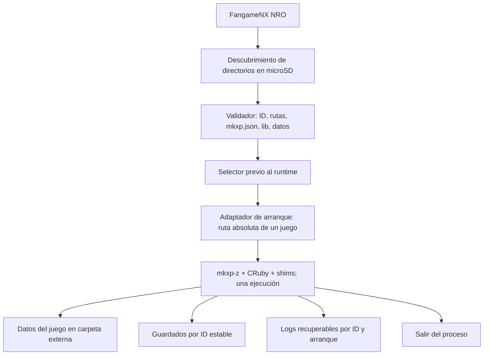

# ADR-004 — Lanzador multijuego de FangameNX

Estado: **propuesta para revisión**, sin implementación. Relacionado con FNX-004 y FNX-005 del [Roadmap](https://docs.google.com/spreadsheets/d/1HxcJIiInc0dQcs_mFLoQ6EQ1qw-cRkqgO1_Iyu-n8WQ/edit), y prepara FNX-006. Fecha: 30 de octubre de 2026.

## Decisión propuesta

Adoptar **un NRO con selector previo al arranque del runtime**. El selector descubre instalaciones bajo una raíz configurable de la microSD, valida su manifestación/configuración y elige una ruta absoluta. Luego se inicializa mkxp-z **una sola vez** para esa ruta. Al terminar el juego, el proceso sale; en la primera versión el usuario vuelve a abrir FangameNX para escoger otro. Esto evita exigir que Ruby, SDL, OpenAL, PhysFS, hilos, cachés y variables estáticas vuelvan a un estado inicial dentro del mismo proceso.

La ruta `/switch/fangame-nx/games/` de la hoja de arquitectura es **provisional**. El almacenamiento de juegos, configuración del launcher, guardados y logs deben quedar separados; no se presupone que el juego ya venga empaquetado ni se copia automáticamente material de terceros. Un ID estable por instalación debe impedir que dos títulos iguales compartan guardados. La compatibilidad de guardados existentes requiere una migración explícita con copia previa, no un movimiento silencioso.

## Por qué esta ruta es viable y qué falta probar

`main.cpp` ya hace `chdir` antes de `Config::read` y acepta un directorio de microSD si tiene `mkxp.json` (`patches/mkxpz-main.cpp.patch:160-303`). El mismo binario se usa en instalaciones de distintos juegos; los perfiles se aplican durante el empaquetado, no en el motor. Por tanto, la selección de una ruta externa **antes** de arrancar el motor es una extensión acotada del arranque. No está probado que una ruta arbitraria fuera de `sdmc:/switch/<slug>` funcione de extremo a extremo ni que el preflight admita un juego pequeño.

El cierre de mkxp-z destruye `SharedState`, espera al hilo RGSS y libera SDL/OpenAL, pero `nx_carpeta_juego_fija` no admite una segunda ruta y hay estado global de título, diagnóstico y logs (`nx_juego.c`). CRuby ejecuta `ruby_cleanup`; no hay contrato ni prueba de reinicialización completa del proceso para otro juego. Por ello, **no se promete retorno al selector tras jugar**. [mkxp-z v2.4.2](https://github.com/mkxp-z/mkxp-z/blob/v2.4.2/src/main.cpp) muestra el ciclo general; el fork añade más estado.

## Alternativas evaluadas

| Alternativa | Resultado |
| --- | --- |
| Seguir con un NRO/NSP por juego | Reutiliza el binario y ya admite carpetas preparadas; no ofrece una biblioteca central ni evita el reempaquetado de metadatos por juego. Útil como base de comparación. |
| Reiniciar Ruby y el motor dentro del mismo proceso | Aplazado. Exige demostrar limpieza de singletons, GC, GL, audio, PhysFS, hilos y shims; el estado estático actual impide cambiar carpeta sin modificaciones. Alto coste y riesgo de contaminación entre juegos. |
| Lanzador NRO separado que encadena otro NRO | Candidato posterior. libnx documenta `envHasNextLoad`/`envSetNextLoad`, condicionados por el cargador. Falta probar disponibilidad, argumentos y retorno en hbmenu y en el contexto NSP; no sirve como supuesto del primer prototipo. |
| Un NSP con `romfs:/juego.txt` por juego | El flujo actual fija la ruta al empaquetar. No resuelve selección dinámica desde una sola instalación. |
| Detectar y ejecutar una carpeta cruda de XP directamente | Rechazado para el primer prototipo: faltan `mkxp.json`, shims, normalización de datos y tratamiento de DLL/archivos; detectar el título no equivale a hacerla ejecutable. |

## Primer prototipo recomendado: FNX-006, sujeto a revisión de esta auditoría

Un arranque sin interfaz gráfica, con **ruta configurable** a una instalación sintética o autorizada ya preparada. La capa de selección se prueba antes de SDL/CRuby; el motor se inicia una vez. Se usan dos carpetas de prueba distintas sin recompilar el NRO entre pruebas. Esta tarea **no** implementa el prototipo.

### Criterios de aceptación propuestos

1. Una build documentada con versiones, checksums, comandos y logs; el mismo NRO puede elegir A y B en ejecuciones separadas sin recompilar ni generar un NRO por juego.
2. Solo se aceptan directorios bajo la raíz configurada, con ruta canónica, sin escape por `..`, enlace o nombre ambiguo; faltas de `mkxp.json`, `lib/` o datos dan errores legibles y no arrancan otro juego.
3. Los logs identifican ID, ruta y método de selección, y quedan recuperables incluso si falla el arranque. No se mezclan registros ni guardados de A y B.
4. Una fixture RGSS pequeña no queda bloqueada por umbrales heredados de cantidad de archivos o por `lib/socket.rb` si no lo necesita. La corrección de esos supuestos exige pruebas antes de cambiar el motor.
5. Se registra por separado: prueba sintáctica, ejecución en emulador y ejecución en Switch física. Solo esta última permite afirmar que funciona en Switch. Entrada, audio, guardado/carga y suspensión se miden en tareas posteriores según el Roadmap.
6. No se distribuyen recursos, scripts ni claves de juegos ajenos. El paquete de prueba contiene solo material sintético o con autorización documentada.

### Dependencias antes de empezar

Revisar este ADR, resolver el entorno de FNX-003 y los huecos de licencias de FNX-002. Definir la fixture y el ID estable. FNX-007 (aislamiento de guardados), FNX-008 (diagnóstico) y FNX-009/010 (biblioteca e interfaz) se diseñan sobre un arranque FNX-006 medido, no sobre compatibilidad supuesta.
