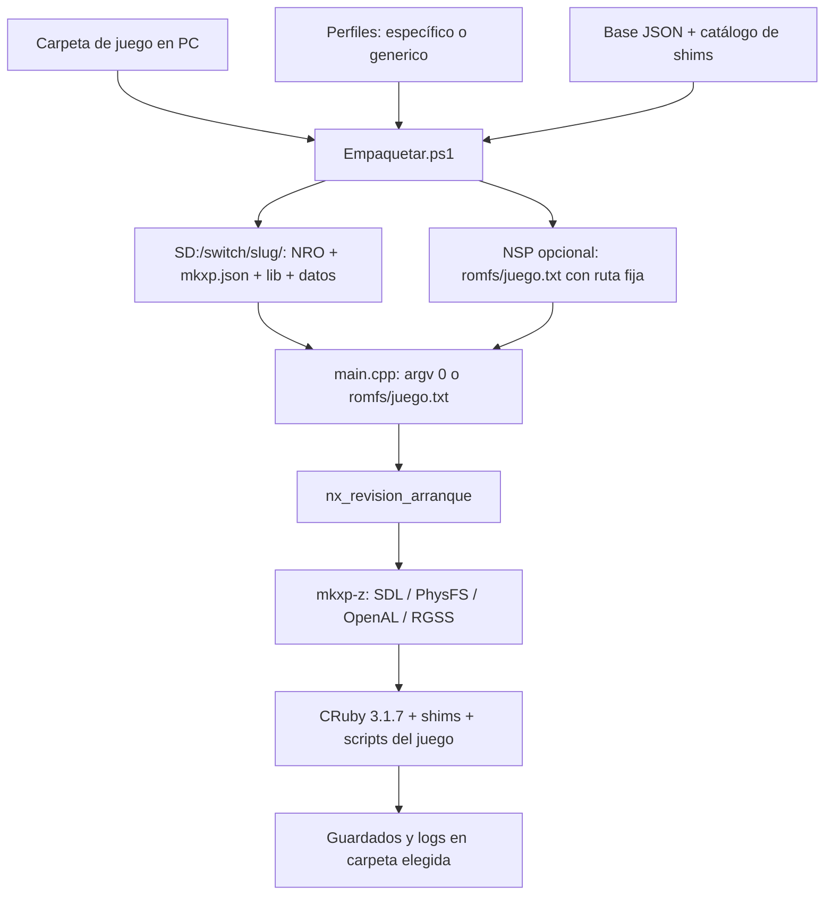

# Misión 001 — Auditoría técnica de rgss-switch

Fecha: 30 de octubre de 2026. Base: `upstream/main` en `0e02a8a`, fork en `b8bd3ec`. Alcance: lectura de código y documentación, verificaciones estáticas locales y fuentes primarias indicadas al final. No se ha compilado ni ejecutado FangameNX.

## Cómo leer los resultados

- **Observado**: código del checkout o salida de un comando ejecutado en este equipo.
- **Documentado**: prueba o afirmación del proyecto original; no repetida aquí.
- **Inferido**: consecuencia técnica razonada que aún exige prototipo.
- **Pendiente**: falta una prueba o una fuente de licencia.

## FNX-001 — Inventario y arquitectura heredada

| Pieza | Función y acoplamiento observado | Fuente |
| --- | --- | --- |
| mkxp-z 2.4.2 | Núcleo C++ de RGSS, gráficos, audio, archivos y enlace con Ruby. Sus fuentes `src/mkxp-z` no están versionadas; `mkxp-z-nx/Makefile` enumera las fuentes externas y añade `nx/*.c,cpp`. | `mkxp-z-nx/Makefile:35-153`, `reconstruir-src.py:1-37` |
| CRuby 3.1.7 | Un intérprete estático para todos los perfiles. Los parches de `patches/000*.patch` adaptan Ruby a Horizon y semántica antigua; `runtime/lib/nx-ruby18.rb` aporta compatibilidad de fuente/API. | `build-ruby-switch.sh:1-56`, `README.md:161-207` |
| Backend Switch | `nx_juego.c` guarda carpeta, título y diagnóstico en variables estáticas; `nx_aviso.c` verifica la instalación; otros `nx/` cubren entrada, audio, red, pantalla, archivos y logs. | `mkxp-z-nx/nx/nx_juego.c:24-59`, `mkxp-z-nx/nx/nx_aviso.c:345-500` |
| Configuración y adaptadores | `runtime/mkxp.base.json` fija RGSS 1 y opciones de Switch. `runtime/lib` contiene shims comunes; `runtime/shims/catalogo.json` resuelve los opcionales y por familia. | `CONVENCIONES.md:103-137`, `runtime/mkxp.base.json:1-64` |
| Perfiles | Nueve JSON válidos: uno genérico y ocho específicos. El perfil decide detección, familia, configuración, shims, rutas sueltas e icono; el motor no lee perfiles. | `juegos/README.md:1-68`, `Empaquetar.ps1:374-421` |
| Empaquetador | PowerShell reconoce juego/familia, compone `mkxp.json`, copia recursos y shims, y rehace NRO con icono/NACP. Puede crear NSP con `romfs:/juego.txt` y claves del propietario. El resultado se prepara por juego, aunque el cuerpo del motor sea común. | `Empaquetar.ps1:430-473,819-953,1309-1450`, `CONVENCIONES.md:82-102` |
| Build y distribución | `build-deps*.sh`, `build-ruby-switch.sh`, `finalize-ruby.sh`, `construir.sh`. `nro.yml` es experimental; `release.yml` crea borradores tras una etiqueta. | `README.md:303-341`, `.github/workflows/` |

Hay **82 parches** versionados. `src/`, `out/`, `release/` y las bibliotecas compiladas no vienen en el clon. El propio `reconstruir-src.py` requiere `src/mkxpz.tar.gz`; su comentario dice que viaja en el árbol, pero en este checkout no está. Esa discrepancia impide comprobar ahora que los parches reconstruyen exactamente mkxp-z.

## FNX-004 — Selección actual y directorios externos

**Observado:** el parche `patches/mkxpz-main.cpp.patch:138-269` prueba el directorio de `argv[0]` y luego una ruta guardada en `romfs:/juego.txt`. Acepta un directorio si contiene `mkxp.json`, hace `chdir` y llama a `nx_carpeta_juego_fija`. Esta última ignora nuevas rutas después de la primera (`nx_juego.c:34-59`). `Config::read` y el motor arrancan después de esa decisión. No existe explorador ni selector dinámico en el checkout.

**Viabilidad delimitada:** una carpeta externa de microSD puede ejecutarse **sin recompilar el motor** si antes se prepara con el NRO, `mkxp.json`, `lib/` y datos que el arranque espera. Eso es lo que hace el empaquetador para cada juego. Una carpeta cruda de RPG Maker XP no cumple automáticamente el contrato; un NSP actual lleva una ruta fija por juego. Hoy no hay un único NRO central que permita escoger sucesivamente varios directorios.

**Acoplamientos concretos:** `nx_aviso.c:345-353` exige `lib/socket.rb` con una justificación del plugin Cable Club y `nx_aviso.c:401-420` rechaza un ZIP con menos de 1000 entradas cuando no hay datos sueltos. Son supuestos heredados de juegos grandes que pueden bloquear una prueba RGSS pequeña. `runtime/mkxp.base.json` fija `rgssVersion: 1`; los perfiles específicos seleccionan shims y algunos contienen iconos o parches solo útiles para su juego. `Empaquetar.ps1` fija `sdmc:/switch/<slug>` al crear el romfs del NSP y rehace NRO por juego. No se han probado aún rutas arbitrarias, validación contra escape de directorio ni aislamiento ante títulos duplicados.

La búsqueda de referencias en código también muestra `runtime/lib/nx-teclado.rb` ajustado a pantallas de Essentials y shims del catálogo como `nx-eventos-lejos.rb` orientados a v21. El catálogo permite activarlos por perfil, pero los tres shims de `runtime/lib` se cargan siempre (`Empaquetar.ps1:104-113,776-787`). La distinción entre corrección de RGSS, compatibilidad de familia y ajuste de juego necesita pruebas con una fixture no Pokémon.

## Compatibilidad RPG Maker XP / Pokémon Essentials

El núcleo mkxp-z admite RGSS 1–3 en su código general, pero **esta entrega se configura para RPG Maker XP / RGSS 1**. El Ruby compilado es 3.1.7. `juegos/README.md:53-66` distingue `ruby31`, `ruby18` y `rgss1` por DLL y cadenas del ejecutable: es una heurística de empaquetado, no garantía de ejecución. Los juegos de Ruby 1.8 necesitan transformación de fuente y sustitutos de `Win32API`; las DLL nativas de Windows y APIs exclusivas de un fork de mkxp-z exigen adaptadores o quedan sin soporte. `Data/Scripts/` de Essentials v20+ debe quedar fuera de PhysFS para que Ruby lo lea con `Dir`/`File` (`Empaquetar.ps1:1410-1421`).

| Familia documentada | Ejemplos heredados | Estado de esta auditoría |
| --- | --- | --- |
| Ruby 3.x / Essentials v19–v21.1 | Reborn, Vanguard, Añil | Hay perfiles y registros previos. Ninguno se ha ejecutado aquí. Plugins y métodos propios de forks varían. |
| Ruby 1.8 embebido / Essentials clásico | Z, Ópalo, Iberia, Titán | Existe `nx-ruby18.rb` y parches de Ruby. No se ha ejecutado la batería local por falta de Ruby y juegos autorizados. |
| RGSS1 original / Ruby 1.8 | Uranium | El perfil usa sustitutos de audio; el estado documentado no equivale a compatibilidad general. |
| Futuro fangame sin perfil | `generico/perfil.json` | Se empaqueta según heurística. No hay evidencia de que arranque ni de que las APIs ajenas estén cubiertas. |

La tabla de `README.md:222-239` resume pruebas anteriores del autor, incluso una de Ópalo en hardware. `GUIA.md:82-100` mantiene una tabla anterior que aún marca varios juegos «sin probar». Para FangameNX prevalece el **registro de prueba fechado y reproducible**, no una etiqueta `jugable` sin alcance. La hoja [FangameNX Context — Compatibility](https://docs.google.com/spreadsheets/d/1HxcJIiInc0dQcs_mFLoQ6EQ1qw-cRkqgO1_Iyu-n8WQ/edit) marca todos los juegos como no probados para este proyecto.

## FNX-003 — Build y verificaciones

`construir.sh:29-59` espera devkitPro/devkitA64, switch-tools, fuentes y bibliotecas ya portadas. El Makefile fija `C:/devkitPro`; si falta `cygpath`, su ruta de respaldo es `C:/rgss-switch` (`mkxp-z-nx/Makefile:18-35`), distinta de la ubicación de este fork. La CI usa `devkitpro/devkita64:latest` sin fijar digest y declara que el flujo Linux completo no se ha ejecutado de punta a punta (`.github/workflows/nro.yml`). No hay ejecuciones visibles de `nro.yml` en los repositorios consultados con `gh run list`.

| Comprobación no destructiva | Resultado |
| --- | --- |
| Git (`git fsck --no-reflogs --full`, `git diff --check`) | Salida limpia. |
| Perfiles `juegos/*/perfil.json` con `json.load` | 9 de 9 parsean. |
| Parser de PowerShell para 5 `.ps1`, incluido `Empaquetar.ps1` | 0 errores de sintaxis. |
| `bash -n` de seis guiones de build/empaquetado | Código de salida 0. |
| `C:/devkitPro`, `src/mkxp-z`, `src/ruby-3.1.7`, `out/nx/lib/libruby-static.a`, NRO y `release/` | Ausentes. No se ejecutó compilación. |
| Ruby local y compilador `aarch64-none-elf-g++` | Ausentes. No se ejecutaron `comprobar-ruby18.rb` ni pruebas RGSS. |
| `python reconstruir-src.py` | Terminó informando que falta `src/mkxpz.tar.gz`; no reconstruyó ni alteró fuentes. |

Estas verificaciones prueban sintaxis y estado Git; **no** prueban que el build enlace, que un juego arranque ni que funcione en Switch. FNX-003 queda bloqueado para reproducción hasta disponer de SDK/fuentes y un entorno autorizado. Guardar versiones, checksums, comandos y logs será requisito de cierre.

Pruebas heredadas disponibles para una fase con entorno completo: `hello-ruby-nx/` ejercita el intérprete aislado, `comprobar-ruby18.rb` comprueba la capa de Ruby 1.8 en PC, `runtime/diagnostico/` reúne sondas y `docs/pruebas/` conserva registros narrados por juego. No constituyen una suite ejecutada sobre este fork. `comprobar-ruby18.rb` crea archivos de prueba durante su ejecución, así que no se invocó en una auditoría de solo lectura.

## FNX-002 — Licencias y recursos

`LICENSE` contiene GPL versión 2; `LICENCIAS.md` declara GPLv2 o posterior para el código propio. Los parches de CRuby siguen Ruby/BSD-2 y los de mkxp-z GPLv2+. Hay dos shims copiados de Empo, uno CC0 y otro GPLv2+ según el inventario. Enlace estático con mkxp-z GPLv2+ condiciona la distribución del conjunto; deben conservarse fuente correspondiente, avisos y licencias de cada componente. Esta es una revisión técnica, no una validación jurídica.

El inventario de `LICENCIAS.md:68-90` cubre los componentes principales, pero `mkxp-z-nx/Makefile:143-152` enlaza además Theora, Vorbis/Ogg, mpg123, modplug, FreeType, HarfBuzz, PNG/JPEG/WebP, bzip2, EGL/glapi/drm_nouveau y otras bibliotecas sin una fila individual allí. **Pendiente:** obtener las licencias y versiones exactas del toolchain/portlibs usado en una compilación y generar avisos de entrega verificables. No se han descargado esas dependencias.

El clon ya contiene **76 imágenes**: 73 capturas en `docs/capturas/`, un icono de perfil (`juegos/pokemon-anil/icono.jpg`) y dos imágenes del motor. `LICENCIAS.md` atribuye expresamente las dos imágenes del motor; no documenta por separado derechos de cada captura o del icono de perfil. No se añadieron recursos. Antes de publicar una distribución nueva hay que revisar procedencia, permiso y necesidad de estas imágenes; tampoco se deben incluir juegos, scripts extraídos ni `prod.keys`.

Los adaptadores Ruby bajo `juegos/*/lib/` son específicos de perfiles y no aparecen enumerados individualmente en la tabla de código propio de `LICENCIAS.md`; revisar sus cabeceras y procedencia antes de atribuirles una licencia uniforme. El origen documentado de los dos shims de Empo no sustituye la conservación de sus avisos en una entrega.

## Riesgos y cierre por Roadmap

| ID | Hallazgo / estado | Próxima evidencia necesaria |
| --- | --- | --- |
| FNX-001 | Inventario y diagrama documentados; fuentes externas ausentes. | Fijar versiones y checksums de todos los tarballs y portlibs. |
| FNX-002 | Licencias principales identificadas; avisos de enlace y derechos de imágenes incompletos. | Inventario por binario y procedencia de 76 imágenes. |
| FNX-003 | Sintaxis y Git comprobados; build no reproducido. | SDK autorizado, fuentes, comandos y logs de una compilación limpia. |
| FNX-004 | Carpeta externa preparada viable sin recompilar; selección central y retorno no existen. | Prototipo de selección de ruta y prueba de salida/reentrada. |
| FNX-005 | Propuesta y alternativas en `ADR-004-lanzador.md`; sin implementación. | Revisar ADR y validar límites en hardware antes de cerrar diseño. |

Riesgos prioritarios: DLL de Windows (R-001), Ruby/RGSS y versiones de Essentials (R-002), supuestos específicos en la verificación de arranque (R-003), confundir logs históricos con pruebas de FangameNX (R-004), derechos de imágenes/avisos (R-005) y guardados que un juego escriba fuera de su carpeta (R-006). No se asigna una probabilidad numérica sin pruebas.

## Fuentes externas consultadas

- [mkxp-z v2.4.2, `src/main.cpp`](https://github.com/mkxp-z/mkxp-z/blob/v2.4.2/src/main.cpp): ciclo de `SharedState`, ejecución de scripts y cierre de SDL.
- [libnx, `env.h`](https://switchbrew.github.io/libnx/env_8h.html) y [implementación `env.c`](https://github.com/switchbrew/libnx/blob/master/nx/source/runtime/env.c): capacidad condicional de cargar otro NRO.
- [FangameNX Context — Roadmap](https://docs.google.com/spreadsheets/d/1HxcJIiInc0dQcs_mFLoQ6EQ1qw-cRkqgO1_Iyu-n8WQ/edit): objetivos y criterios FNX-001 a FNX-005 consultados el 30/10/2026.
